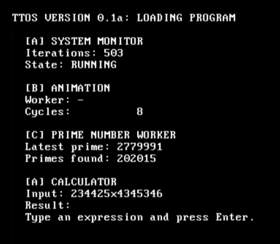
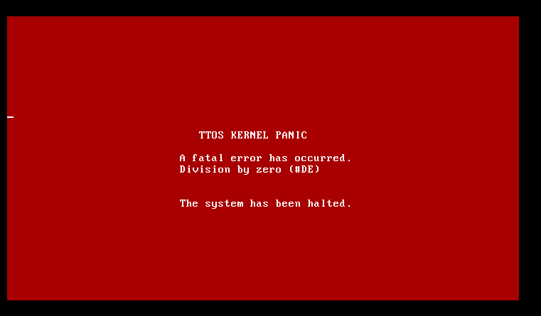

# TungTung OS
A 32-Bit, multi-ring, operating system, written from scratch in just assembly and C++, capable
of running on real hardware, using a custom Bootloader targetting legacy BIOS systems.



## Technical Details
 - Premtive Multitasking Support
 - Seperately compiled userspace
 - Custom Bootloader written in x86 assembly
 - Keyboard Driver
 - VGA Teletype Driver
 - Support for SSE Instructions
 - Paging
 - Ring 3 Support with custom syscalls
 - Kernel Panics:



## Sign me up!!
Install today! Go to the releases tab and get your .img today, launch with qemu, or run on real
hardware if you dare.

Run on Qemu:
```
qemu-system-i386 -drive format=raw,file=<FILE NAME>
```  

Flash to a real iso (at your own risk!)
```
sudo dd if=<FILE NAME> of=/dev/sdX bs=4M status=progress conv=fsync
```

## Build
Ensure `python3`, `nasm`, `g++`, and any linker that supports intel i386 is installed. Run:

```sh
python3 build.py
chmod +x build.sh
./build.sh
```
